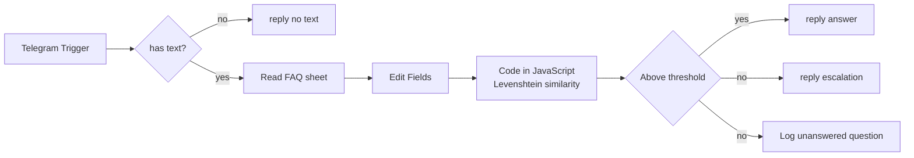
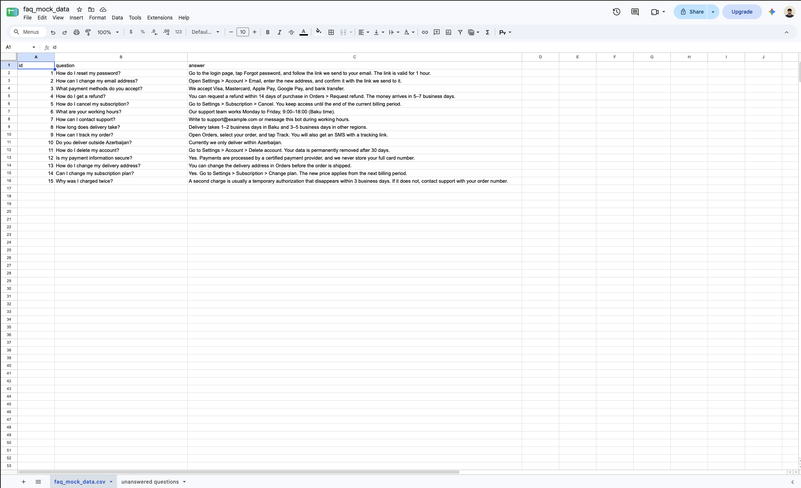
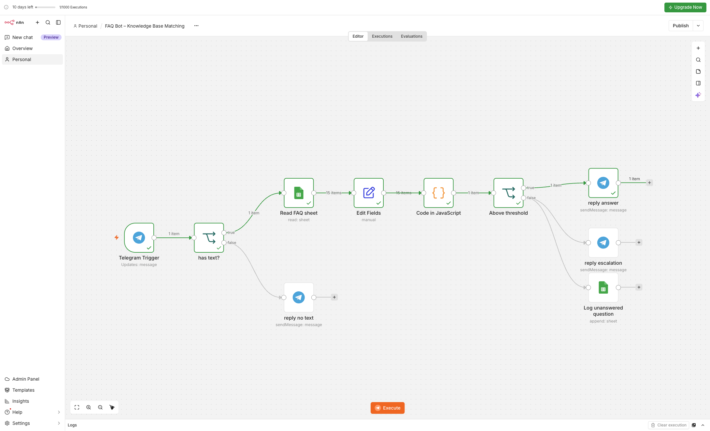
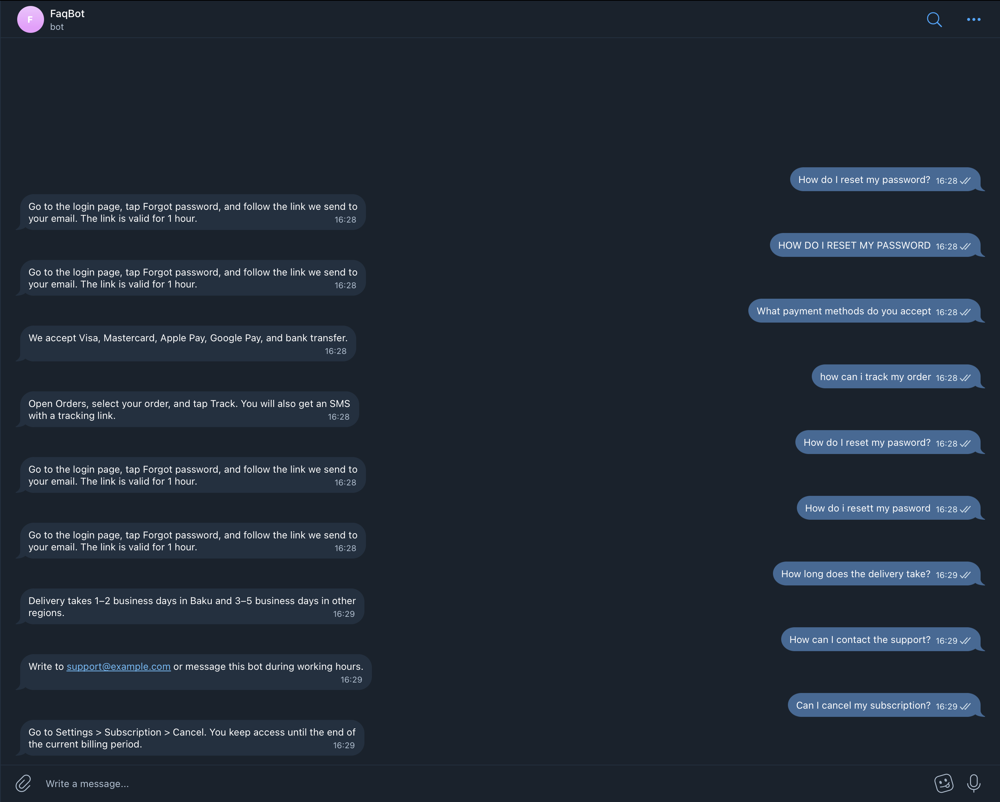
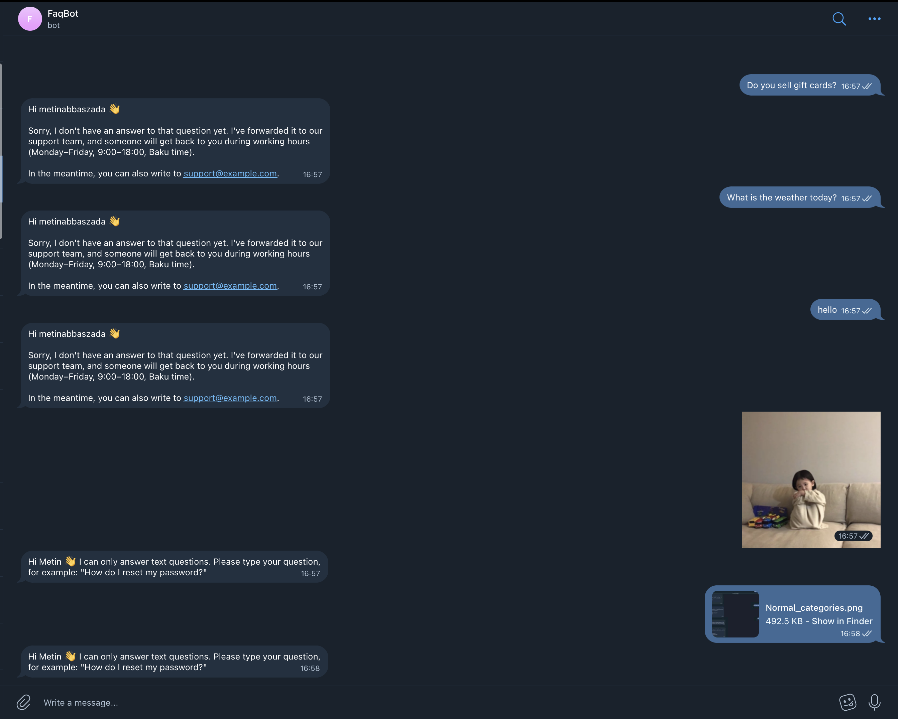
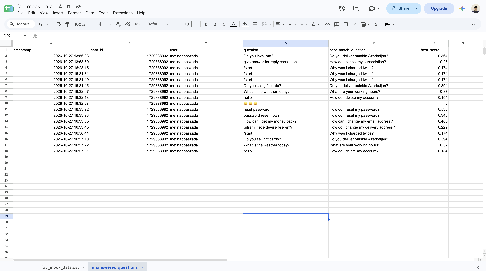

# Telegram FAQ Bot with Fuzzy Matching (n8n + Google Sheets)

A Telegram bot built in n8n that answers frequently asked questions from a **Google Sheet** of question/answer pairs. Instead of a fixed button menu, a JavaScript Code node computes a **Levenshtein-based similarity score** between the user's question and every stored question. The bot answers only when the best match is above a threshold; otherwise it **escalates instead of guessing** and logs the question so the FAQ set can grow over time.

This is a simple form of **retrieval**: find the most relevant stored entry for a free-text query, then decide whether it is relevant enough to use.

---

## Project structure

```
.
├── workflow/
│   └── faq_bot_workflow.json    # n8n workflow (import this)
├── data/
│   └── faq_mock_data.csv        # FAQ question/answer pairs used in the sheet
├── tools/
│   └── faq_similarity.py        # same algorithm in Python, for testing scores in a terminal
├── screenshots/               # workflow canvas, Telegram tests, sheet tabs
└── README.md
```

---

## Architecture



| Node | Purpose |
|---|---|
| **Telegram Trigger** | Receives the user's message |
| **has text?** | Stickers, photos and files get a polite "text only" reply |
| **Read FAQ sheet** | Reads all question/answer rows from Google Sheets (one item per row) |
| **Edit Fields** | Adds the user's question, `chat_id` and username to the rows |
| **Code in JavaScript** | Code node (*Run Once for All Items*): scores every FAQ question and returns one item with the best match |
| **Above threshold** | Routes on the `matched` flag computed in the code |
| **reply answer** | Sends the stored answer |
| **reply escalation** | Tells the user the question was forwarded to the team |
| **Log unanswered question** | Appends the question, best match and score to the *unanswered questions* tab |

---

## How the matching works

1. **Normalize** both texts: lowercase, replace punctuation with spaces, collapse spaces. Unicode-aware (`\p{L}`), so Azerbaijani and Russian letters are kept.
2. **Levenshtein distance**: the minimum number of single-character insertions, deletions and replacements needed to turn one string into the other, computed with a dynamic-programming table (`dp[i][j]` = distance between the first `i` and `j` characters).
3. **Similarity score** between 0 and 1, so short and long questions are comparable:

   `similarity = 1 − distance / length of the longer string`

4. Compare the user's question with **every** row and keep the highest score.
5. If `score ≥ THRESHOLD` (0.7) → answer; otherwise → escalate and log.

The matching is fully generic: adding a new row to the sheet makes it answerable with **no change to the workflow**.

---

## Spreadsheet

One Google Sheets file with two tabs:

**faq_mock_data.csv**: `id | question | answer` (15 sample pairs in [`data/faq_mock_data.csv`](data/faq_mock_data.csv))



**unanswered questions**: `timestamp | chat_id | user | question | best_match_question_ | best_score` (timestamps in Baku time)

`best_match_question_` and `best_score` show how close an unanswered question came, which is the data used to tune the threshold and to decide which FAQs to add.

---

## Threshold tuning

Scores measured with the sample FAQ set (threshold 0.7):

| User question | Score | Result | Best match |
|---|---|---|---|
| How do I reset my password? | 1.000 | ✅ answered | How do I reset my password? |
| HOW DO I RESET MY PASSWORD | 1.000 | ✅ answered | (normalization) |
| How do I reset my **pasword**? | 0.962 | ✅ answered | (1 typo tolerated) |
| How do i **resett** my **pasword** | 0.923 | ✅ answered | (2 typos tolerated) |
| How long does **the** delivery take? | 0.871 | ✅ answered | How long does delivery take? |
| **Can** I cancel my subscription? | 0.806 | ✅ answered | How do I cancel my subscription? |
| Do you sell gift cards? | 0.394 | ↗️ escalated | Do you deliver outside Azerbaijan? |
| What is the weather today? | 0.370 | ↗️ escalated | What are your working hours? |
| hello | 0.154 | ↗️ escalated | How do I delete my account? |

**Trade-off:**
- **Lower threshold** → more tolerance for typos and small rephrasings, but a higher risk of confidently answering the *wrong* question.
- **Higher threshold** → fewer wrong answers, but more legitimate questions get escalated.

For a support bot, a wrong answer is worse than an escalation, so the threshold errs on the strict side. With 0.7, typos, capitalization and small wording changes score above ~0.8, while unrelated questions stay below ~0.4, leaving a clear margin on both sides.

To test any question locally:
```bash
python3 tools/faq_similarity.py "how can i get my money back"
```

---

## Setup

1. Create a Telegram bot with [@BotFather](https://t.me/BotFather) (a separate bot from any other workflow, since a bot can have only one webhook).
2. Create a Google Sheet with the two tabs above and import `data/faq_mock_data.csv` into the first tab (**faq_mock_data.csv**). Name the second tab **unanswered questions**.
3. In n8n, import `workflow/faq_bot_workflow.json`.
4. Create credentials for **Telegram API** and **Google Sheets**, and select your sheet and tabs in **Read FAQ sheet** and **Log unanswered question**.
5. Publish the workflow.

Built and tested on **n8n Cloud** (no local services needed, since there is no local LLM in this project).

---

## Robustness

| Case | Handling |
|---|---|
| Non-text message (sticker, photo, file) | `has text?` → "text questions only" reply |
| Question with typos or different capitalization | Normalization + edit distance |
| No good match | Escalation reply + row in *unanswered questions* |
| Empty or incomplete FAQ rows | Skipped by the code |
| Emoji-only or non-Latin input | Normalization keeps all Unicode letters; no match → escalated with score 0 |

---

## Screenshots

### Workflow


### Telegram: answered questions
Exact matches, uppercase, typos and small rephrasings all get the stored answer.



### Telegram: escalations and non-text messages
Unrelated questions get the escalation reply; a photo and a file get the "text questions only" reply.



### Logged unanswered questions
